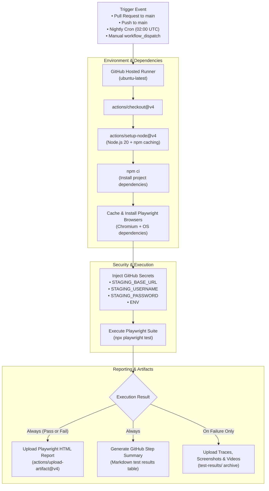

# Industry-Standard CI/CD Implementation Plan for Playwright Test Suite

**Target Repository:** [https://github.com/kumar-amit-ids/sample-ci-cd-test](https://github.com/kumar-amit-ids/sample-ci-cd-test)  
**Framework:** Playwright (TypeScript) + Page Object Model  
**CI/CD Engine:** GitHub Actions  
**Document Version:** 1.0.0  
**Date:** 2026-10-19  

---

## 1. Executive Summary

This document specifies the end-to-end implementation plan for an industry-standard, production-grade Continuous Integration and Continuous Deployment (CI/CD) pipeline for the BluKnox Playwright automation test suite.

The pipeline ensures:
- **Zero Secrets in Code**: Environment credentials are dynamically injected via GitHub Secrets.
- **Fast Feedback on Pull Requests**: Smoke tests run automatically on PRs to gate bad merges.
- **Scheduled Regression Runs**: Nightly automated runs to detect staging API regression.
- **On-Demand Manual Triggering**: Flexible dispatch workflow allowing testers to select environment and test tags from the GitHub UI.
- **Rich Failure Artifacts & Reports**: Auto-publishing of Playwright HTML Reports, step summaries, screenshots, videos, and trace viewer files.

---

## 2. High-Level Pipeline Architecture



---

## 3. Step-by-Step Implementation Roadmap

### Step 1: Secure Credentials Management (GitHub Secrets - Option B)
We store the entire environment configuration as a single secret (`ENV_STAGE`) to simplify secret management and eliminate plain-text credentials in the codebase.

#### Action Items:
1. Navigate to your GitHub Repository:
   `https://github.com/kumar-amit-ids/sample-ci-cd-test/settings/secrets/actions`
2. Click **New repository secret**:
   - **Name:** `ENV_STAGE`
   - **Secret:**
     ```env
     BASE_URL=https://staging.bluknox.com
     USERNAME=dup-5@yopmail.com
     PASSWORD=Test@1234567
     ```
3. Click **Add secret**.

---

### Step 2: Configure NPM Test Scripts in `package.json`
Standardize CLI commands for both local developers and CI runners to execute targeted test tiers.

#### Action Items:
Update the `scripts` section in `package.json`:
```json
{
  "scripts": {
    "test": "playwright test",
    "test:smoke": "playwright test --grep @smoke",
    "test:regression": "playwright test --grep @regression",
    "test:headed": "playwright test --headed",
    "test:ui": "playwright test --ui",
    "report": "playwright show-report"
  }
}
```

---

### Step 3: Create GitHub Actions Workflow (`.github/workflows/playwright.yml`)
Create the core workflow file with multi-trigger support, dependency caching, secret injection, and artifact archiving.

#### Action Items:
Create directory `.github/workflows/` and file `playwright.yml` with the following configuration:

#### Workflow Triggers Configured:
1. **`pull_request`**: Runs smoke tests against any PR targeting `main`.
2. **`push`**: Runs smoke tests when code is merged into `main`.
3. **`schedule`**: Runs nightly regression test suite every day at 02:00 UTC (`cron: '0 2 * * *'`).
4. **`workflow_dispatch`**: Manual run with custom UI inputs:
   - **Environment**: Dropdown to select `stage` or `prod`.
   - **Test Tag**: Dropdown to select `@smoke`, `@regression`, or `all`.

#### Key Pipeline Steps in the Workflow:
1. **Checkout Code**: `actions/checkout@v4`.
2. **Setup Node.js**: `actions/setup-node@v4` with `node-version: 20` and `cache: 'npm'`.
3. **Install Dependencies**: `npm ci` (clean, reproducible install).
4. **Cache Playwright Browsers**: Keyed by `package-lock.json` so browser binaries are downloaded only once.
5. **Install Playwright Browsers & OS Dependencies**:
   `npx playwright install --with-deps chromium` (only downloads if cache missed).
6. **Execute Playwright Tests**:
   - Injects `BASE_URL`, `USERNAME`, `PASSWORD`, `ENV`, `CI=true`.
   - Runs appropriate tag based on trigger type.
7. **Publish Test Artifacts**:
   - **Playwright HTML Report**: Retained for 30 days (`actions/upload-artifact@v4`).
   - **Failure Traces & Videos**: Uploaded whenever a test fails (`if: failure()`).
8. **GitHub Step Summary**:
   - Appends Markdown execution summary to `$GITHUB_STEP_SUMMARY` for instant visibility.

---

### Step 4: Validate CI Execution Settings in `playwright.config.ts`
Verify that `playwright.config.ts` has proper CI-aware configurations:
- `forbidOnly: !!process.env.CI`: Prevents accidentally checked-in `test.only` from passing CI.
- `retries: process.env.CI ? 2 : 0`: Automatically retries flaky tests twice on CI.
- `workers: process.env.CI ? 2 : undefined`: Prevents container memory exhaustion on GitHub runners.
- `reporter: [['html'], ['github'], ['list']]`: Enables GitHub Actions step annotations alongside HTML output.

---

### Step 5: Commit, Push and Verify Live Pipeline

#### Action Items:
1. Stage changes:
   ```bash
   git add .github/workflows/playwright.yml package.json playwright.config.ts CI_CD_PLAN.md
   ```
2. Commit:
   ```bash
   git commit -m "ci: add robust github actions workflow for playwright test automation"
   ```
3. Push to GitHub:
   ```bash
   git push origin main
   ```
4. Verification:
   - Open [https://github.com/kumar-amit-ids/sample-ci-cd-test/actions](https://github.com/kumar-amit-ids/sample-ci-cd-test/actions).
   - Observe the live workflow run.
   - Verify artifacts (HTML report, test logs) are uploaded and downloadable.

---

## 4. Verification & Testing Checklist

| Checkpoint | Expected Result | Pass / Fail |
| :--- | :--- | :--- |
| **Secrets Resolution** | Secrets injected into runner environment without printing values in logs | [ ] |
| **Dependency Cache** | Subsequent workflow runs restore `npm` and browser binaries in < 15 seconds | [ ] |
| **Smoke Suite Execution** | All smoke scenarios (`Scenario 1.1`, `Scenario 1.2`) execute and pass on Chromium | [ ] |
| **Report Artifacts** | `playwright-report` zip available under Workflow Run > Artifacts | [ ] |
| **Failure Captures** | When a test fails, trace viewer (`trace.zip`), video, and screenshot are attached | [ ] |
| **Manual Dispatch UI** | Dropdowns for environment (`stage`/`prod`) and tags appear in GitHub Actions tab | [ ] |
| **Step Summary** | Test execution table and status displayed directly on the Actions job summary | [ ] |

---

## 5. Maintenance and Future Enhancements
- **GitHub Pages Integration**: Automatically deploy the HTML test report to `https://kumar-amit-ids.github.io/sample-ci-cd-test/` for one-click browser viewing.
- **Slack / Teams Notifications**: Add incoming webhook step to alert the QA/Dev channel if nightly regression fails.
- **Cross-Browser Matrix**: Expand schedule runs to include Firefox and WebKit (Safari).
